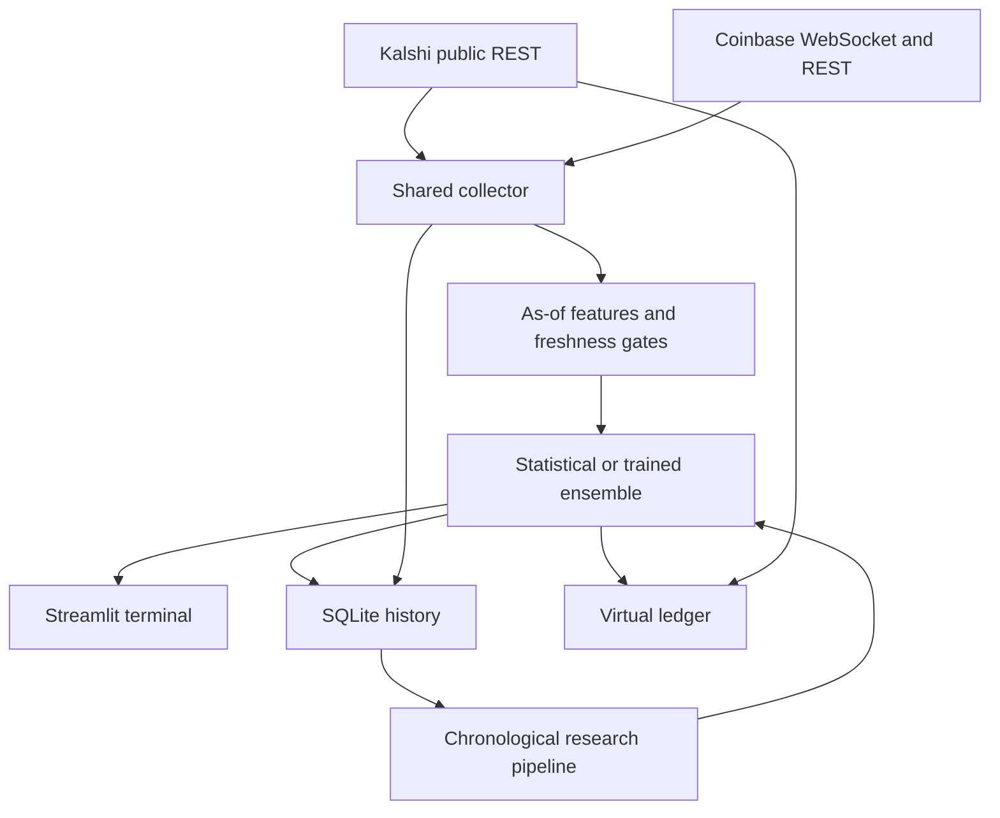

# BTC / 15 — Kalshi research terminal

A read-only Bitcoin probability dashboard for Kalshi's **KXBTC15M** contracts. Streamlit + Plotly, Coinbase WebSocket data, settlement-aware statistical forecasts, optional XGBoost training, and a persistent virtual portfolio.

**Status:** working live-data research application; experimental, uncalibrated proxy baseline by default. No trained model, performance promise, real-money order execution, or trading credentials are included. See [verification boundaries](docs/VALIDATION.md).

## Run

Python 3.11 or 3.12 is recommended.

```bash
python -m venv .venv
source .venv/bin/activate                # Windows: .venv\Scripts\activate
pip install --require-hashes -r requirements.lock
cp .env.example .env                    # Optional; defaults work without credentials
streamlit run app.py
```

Open the local URL printed by Streamlit. Keep one server process per database. The collector is shared across browser sessions through `st.cache_resource`; opening another tab does not start another collector in that process. Settings and the virtual account are shared across sessions, so use a private single-user deployment. Do not expose the server publicly without your own access controls.

For development, `requirements.txt` contains compatibility bounds; `requirements.lock` pins transitive dependencies and hashes. Regenerate deliberately with `uv pip compile requirements.txt --python-version 3.11 --generate-hashes -o requirements.lock`.

## What appears in the terminal

- Active contract ticker, status, official threshold, UTC open/close and countdown.
- Live Coinbase BTC/USD price, 24-hour change, observation age and source.
- UP/YES and DOWN/NO probabilities summing to 100%, with an explicit unavailable state.
- Coinbase candles, MA20, visible-window close-price VWAP, threshold and time markers.
- Probability history alongside Kalshi bid/ask midpoint, marked as non-executable.
- Volatility, RSI, MACD, book imbalance, distance, statistical uncertainty and input-based explanation.
- Kalshi bid/ask quotes, volume, open interest, depth, recent trades, and fee-aware hypothetical EV.
- Officially resolved forecast metrics, separate prediction/contract counts, calibration buckets, rolling accuracy.
- Virtual account, positions, realized return, cost-basis equity curve, drawdown and CSV export.
- Exact retrieved market rules and series metadata.

Live predictions update after each collection cycle (3-second delay plus API latency); the UI refreshes every 2 seconds. Slow providers can exceed the 1–5 second target. Data older than the configured freshness bound does not produce a forecast.

## Settlement target and limitations

The live contract inspected on November 4, 2026 compares the **60-second CF Benchmarks BRTI average before closing** with the **60-second average before opening**, and resolves YES when the ending value is at least the opening value. The ending average is rounded to two decimals. The contract rules and Kalshi's official result control; an exchange spot print does not settle the contract.

The app uses the API's published `floor_strike` as the opening threshold, with the current recognized `at least` / BRTI / sixty-second rule family and 900-second duration. Missing thresholds, unrecognized rules, stale observations or candle gaps suspend forecasts. Review changes to contract rules: this is a conservative rule-family check, not a general legal-rule parser.

**Coinbase is a proxy, not the official settlement index.** BRTI passthrough and Kalshi WebSockets require authentication, and BRTI access requires entitlement. This credential-free release uses public Kalshi REST and Coinbase WebSockets with REST fallback. It does not implement authenticated Kalshi or BRTI feeds.

During the last 60 seconds, an accurate conditional averaging model requires already observed BRTI samples. **This release suspends forecasts during that minute.** It does not replace those samples with Coinbase data. The app continues to display the countdown and market information. Kalshi's `close_time`, not its potentially much later `expiration_time`, defines the prediction horizon.

### Statistical model

Approximate future dollar prices locally by a zero-drift arithmetic Brownian process, with per-square-root-second volatility estimated from up to 120 completed one-minute Coinbase candles. For time remaining `T >= 60`, the variance of the final 60-second mean is:

```text
variance = (spot × sigma)^2 × (T − 40) + basis_sigma_usd^2
P(YES) = NormalCDF((spot − (official_threshold − 0.005)) / sqrt(variance))
```

The half-cent boundary approximates the two-decimal rounding rule for a continuous distribution. Default proxy basis standard deviation is $25, an **assumption, not an estimated or calibrated parameter**. The displayed 95% price range is conditional on these assumptions; it is not a confidence interval on model skill. Drift, jumps, regime shifts, index construction, reference outages, discrete sampling, and source revisions can invalidate the approximation. The model does not estimate the probability of a reference outage (the terms describe missing-data resolution). Probabilities are bounded to [0.001, 0.999] to avoid unwarranted certainty.

Official settlement labels and virtual payouts come only from Kalshi `settled`/`finalized` markets with `yes`/`no` results. Void, disputed, or nonbinary outcomes remain unresolved for manual investigation rather than receiving invented payouts. Official-result corrections after first resolution are not automatically reversed in the ledger.

## Paper simulation

Disabled on every new server start. In Research controls, enable simulation **and** explicitly permit unvalidated proxy forecasts. These controls never enable real orders: there is no order-submission implementation.

The simulator derives YES asks from opposing NO bids, and vice versa. It only assumes fills at the best available level, caps whole-contract quantity at displayed depth and spend limits, and rejects excessive spreads, insufficient liquidity and late entries. Fees use the retrieved quadratic series multiplier:

```text
fee = ceil_to_cent(0.07 × quantity × price × (1 − price) × multiplier)
EV = quantity × estimated_win_probability − entry_cost − fee
break_even_probability = (entry_cost + fee) / quantity
```

A missing or unsupported fee type blocks paper entries. Fees are estimates; changes, waivers, promotions or other special terms may require updates. The default minimum EV is $0.03 per contract, maximum spend $10, maximum cash allocation 2%, one entry per interval, 90-second cutoff. `STARTING_BANKROLL` defaults to $1,000 and applies only to a new database account. There is no deposit/reset operation in the UI.

Simulation is optimistic about latency and queue competition. The quoted size may disappear before a real fill. No order-book walking, market impact, partial fill queue, or latency slippage is modeled; sizes are capped at one level instead. A displayed hypothetical edge is not proof of profitability. Open positions are valued at cost, not marked to market; the reported drawdown is a realized/cost-basis measure.

## Architecture



- `btc15/domain.py`: typed API market parsing, UTC, active-market selection, official labels.
- `btc15/feeds.py`: GET-only clients, throttling, retry/backoff, pagination, fixed-point book parsing, reconnecting Coinbase stream.
- `btc15/features.py`: completed-candle feature builder and missing-data checks.
- `btc15/model.py`: averaging baseline and trusted model-artifact inference.
- `btc15/engine.py`: process-shared collector, rollover, inference and resolution polling.
- `btc15/store.py`: locked WAL SQLite persistence, deduplication and atomic portfolio settlement.
- `btc15/paper.py`: fee math, hypothetical EV and virtual risk limits.
- `research/`: dataset import/export, chronological fitting, calibration, learned blend, walk-forward evaluation and quote replay.
- `tests/`: mocked/unit tests with explicitly synthetic fixtures; no fabricated market results.

## Data, training and evaluation

No legitimate labeled training archive was supplied, so no model artifact is bundled. At least 100 resolved contracts are required to run fitting; this is a mechanical minimum, **not evidence of reliability**. Prefer thousands of contracts spanning volatility regimes and independently held-out dates. Repeated snapshots within a contract are correlated.

As the app runs it stores ticks, prediction features, contemporaneous top quotes and official results in SQLite. Export resolved observations:

```bash
python -m research.dataset runtime.sqlite dataset.csv
python -m research.train dataset.csv --output artifacts/model.joblib
# Or expanding-window reports, requiring at least 250 contracts:
python -m research.walk_forward dataset.csv --output artifacts
```

Restart the app to load a new model. Models are loaded once, never retrained on reruns. **Only load artifacts you created or trust:** joblib/pickle can execute code.

Independent historical sources can be imported:

```bash
python -m research.build_dataset candles.csv snapshots.csv outcomes.csv --output dataset.csv
```

See [dataset schema](docs/DATA.md). Candle timestamps must be interval **end** times. The builder selects only completed observations at/before each prediction and rejects thresholds published in the future. Independently verify provenance and as-of quote availability; timestamp checks cannot prove a vendor's data are authentic.

Training uses whole-contract chronological partitions: 50% fitting, 15% calibration, 15% ensemble selection, 20% untouched testing. Labels not available before the next partition are purged. XGBoost fits features; sigmoid calibration fits only the calibration partition; a blend weight is selected by weighted Brier loss on the ensemble partition. Each contract has equal total fitting/selection weight. Walk-forward runs expanding prefixes before the global final test. Hyperparameters are fixed, not tuned on test results.

Reports include accuracy, Brier, log loss, ECE/reliability buckets, confusion matrix, precision/recall, remaining-time and volatility bins, sample counts/date ranges, and baseline/market/ML/ensemble comparisons. Prediction and last-forecast-per-contract metrics are separate. Zero ensemble weight is valid if the baseline wins validation. A fitted model is not automatically superior or safe to act on.

Replay **only out-of-sample predictions** with real historical executable quote/depth records:

```bash
python -m research.backtest artifacts/model.joblib.test.csv --output backtest.json
```

The replay requires quote timestamps, YES/NO asks and depth, and historical fee multipliers. It rejects absent quote columns and stale/future quotes. It uses one contract per interval and settles after recorded official resolution times, without using winning proceeds before then. It reports after-fee ROI, cost-basis drawdown, win rate, equity and transactions. Accuracy and profitability are different measures. The simple research replay is deliberately more restricted than configurable live paper simulation; do not infer historical books from current snapshots.

## Configuration

| Variable | Default | Purpose |
|---|---|---|
| `KALSHI_BASE` | `https://external-api.kalshi.com/trade-api/v2` | Public API root |
| `DATABASE_PATH` | `runtime.sqlite` | Durable observations and paper account |
| `MODEL_PATH` | `artifacts/model.joblib` | Optional trusted trained artifact |
| `POLL_SECONDS` | `3` | Delay between collection cycles |
| `MAX_DATA_AGE` | `10` | Maximum tick and UI snapshot age, seconds |
| `BASIS_SIGMA_USD` | `25` | Assumed proxy-index basis uncertainty |
| `STARTING_BANKROLL` | `1000` | Initial virtual cash for new DB |
| `LOG_LEVEL` | `INFO` | Logging verbosity |

No API keys are needed. `.env`, databases and trained artifacts are ignored by Git. Back up the SQLite database yourself, preferably using SQLite's backup API while the app is running. Storage grows continuously; retention/compaction and multi-worker coordination are not implemented. The app requires continued operation to record observations and resolve its tracked contracts.

## Tests and troubleshooting

```bash
pytest -q
```

CI runs these offline tests on Python 3.11/3.12. Live tests are intentionally not mandatory in CI. See [VALIDATION.md](docs/VALIDATION.md) for observed verification, not just implementation claims.

- **Pending threshold:** wait for Kalshi to publish it. Never manually substitute spot.
- **Final-minute suspension:** expected without entitled BRTI samples.
- **Stale candles/ticks:** check connectivity and UTC clock. Bounded candle requests avoid stale unbounded API caches. Do not loosen freshness gates just to force output.
- **No paper entries:** both switches must be enabled and all spread/depth/EV/budget/cutoff checks must pass.
- **No performance results:** wait for official settlements. A new installation starts empty.
- **Unknown fee/rule schema:** update the parser after reviewing current official documentation.
- **Permission/429/provider error:** retries are bounded; cached data are labeled and forecasts withheld.
- **Model load failure:** verify trusted artifact schema and package versions; remove the artifact to run the baseline.

## Sources checked

- [Kalshi markets](https://docs.kalshi.com/api-reference/market/get-markets)
- [Kalshi order books](https://docs.kalshi.com/api-reference/market/get-market-orderbook)
- [Series metadata](https://docs.kalshi.com/api-reference/market/get-series)
- [CRYPTO contract terms](https://assets.kalshi.com/contract_terms/CRYPTO.pdf)
- [CF Benchmarks passthrough and entitlement](https://docs.kalshi.com/cfbenchmarks/rest-passthrough)
- [Kalshi WebSocket authentication](https://docs.kalshi.com/getting_started/quick_start_websockets)
- [Kalshi fee schedule](https://kalshi.com/fee-schedule)
- [Coinbase channels](https://docs.cdp.coinbase.com/exchange/websocket-feed/channels)

## Private GitHub publishing

The supplied source is repository-ready. The connected GitHub tool could read the account but did not expose repository creation; the local CLI was unauthenticated. **No remote repository or push is claimed.** After authenticating your local GitHub CLI:

```bash
git init -b main
git add .
git commit -m "Build BTC 15-minute research terminal"
gh repo create kalshi-btc15m-ai-predictor --private --source=. --remote=origin --push
```

No open-source license is included because public release was not selected.

Research and hypothetical simulation only. This application is not investment advice and does not establish that any strategy has an edge.
